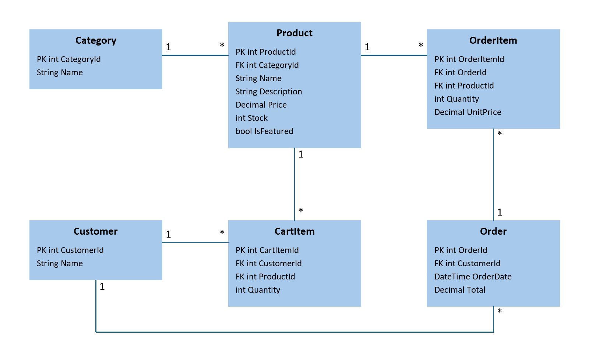

# Offline Shopping App

This is my Assignment 11 project. It is a .NET MAUI app that works like a small offline store. It uses MVVM and saves everything in a local SQLite database, so no internet is needed.

## What the app does

- Choose a customer from the list (no login)
- See all the products with their category, price and stock
- Open a product and add a quantity to the cart
- View the cart, remove items and see the total
- Check out, which creates an order and lowers the stock

## How to run it

1. Open `OfflineShoppingApp.csproj` in Visual Studio.
2. Pick an Android emulator (or Windows Machine).
3. Press Run.

## ERD

## Why OrderItem has its own price

OrderItem saves the price the customer paid at checkout. If the product's price changes later, the old order still shows the price that was actually paid, so the order total stays correct.

## Product pictures

The product pictures are in `Resources/Images` (product1.jpg to product8.jpg). They are not saved in the database. The app finds the right picture using the ProductId. The pictures are sample photos from Unsplash, Netashop and Slowtide, used only for this assignment.
